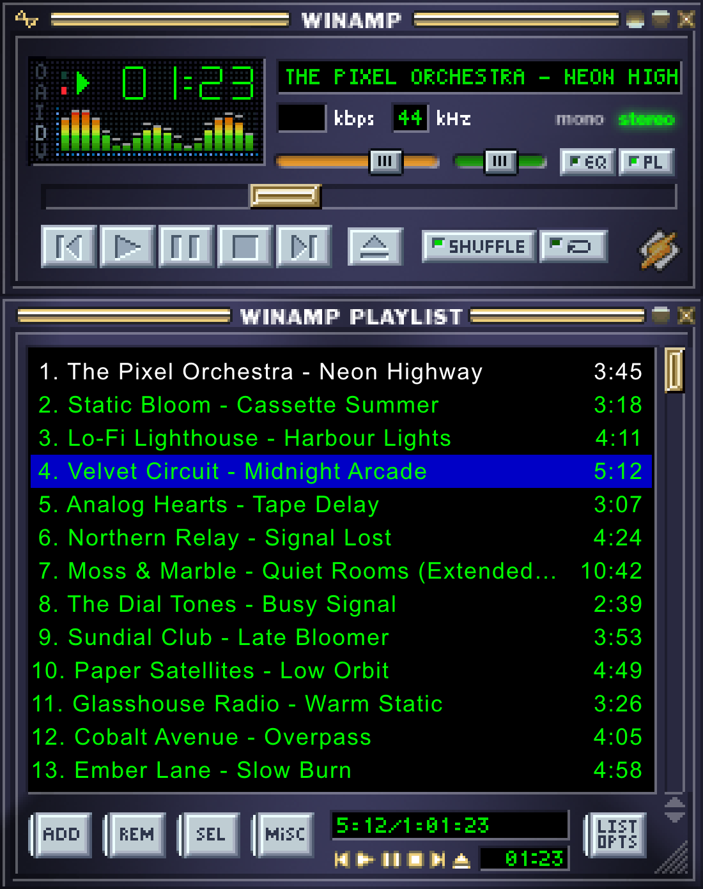
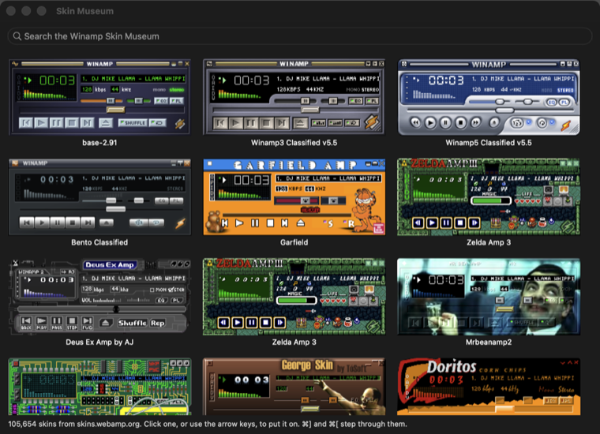
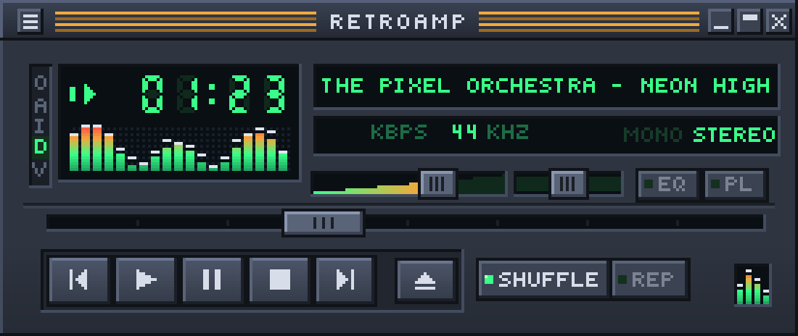

# Retroamp

**A Winamp-style player for the Spotify desktop app on macOS.**

<p align="center">
  
  <br>
  <sub>The Winamp 2.91 base skin, with made-up tracks.</sub>
</p>

Retroamp puts the classic 275×116 main window and the playlist editor on top of the Spotify desktop app. Spotify still does the playback. Retroamp is a remote control, playlist browser and visualizer for it.

## Features

- **The classic look.** Both windows are drawn from a skin's sprite sheets with sharp pixels, at the original size or resized up to 3×.
- **Classic skins.** The default is the Winamp 2.91 base skin, which Retroamp downloads on first launch. It loads any Winamp 2.x `.wsz` skin, has an original built-in skin of its own, and has a browser for the Winamp Skin Museum's 100,000-odd skins that puts each one on as you click it.
- **A real visualizer.** Spotify's actual audio drives the spectrum analyzer and oscilloscope, through a Core Audio process tap.
- **Your Spotify library.** The playlist editor shows Spotify's queue, your playlists and Liked Songs, through the Spotify Web API.
- **Spotify stays in the background.** Retroamp starts tracks, playlists and DJ in ways that don't bring Spotify's window to the front.
- **Spotify DJ.** The logo at the bottom right is a DJ button. It starts DJ, or gets different picks while DJ plays.
- **Classic keyboard controls.** Z X C V B work as they always did, plus shortcuts for links, skins and DJ.
- **No Xcode, no dependencies.** `build.sh` is a single `swiftc` call using Apple's Command Line Tools.

## Requirements

- macOS 14.2 or later, because the visualizer uses Core Audio process taps.
- The Spotify desktop app. The web player isn't supported.
- Apple's Command Line Tools (`xcode-select --install`). Xcode itself isn't needed.
- For the playlist editor only: a free Spotify developer app, whose owner has Spotify Premium (see [Connecting Spotify](#connecting-spotify)).

## Build and run

```sh
git clone https://github.com/amertkara/retroamp.git
cd retroamp
./build.sh
open build/Retroamp.app
```

To keep it around, copy `build/Retroamp.app` to `/Applications`.

### Why `build.sh` doesn't run `codesign`

Binary-allowlisting tools such as Santa trust executables that come straight out of the compiler. Re-signing with `codesign` changes the file's hash, and then the app gets blocked.

Instead, `build.sh` keeps the linker's ad-hoc signature, named after the bundle ID `local.retroamp`, and only moves the file into the bundle.

If your Mac still blocks it, request approval through the link in the block dialog.

## Permissions

macOS asks for these the first time they're needed:

1. **Automation → Spotify.** This lets Retroamp read the current track and control playback.
   - If you decline, the display shows `RETROAMP NEEDS PERMISSION TO CONTROL SPOTIFY`.
   - To turn it back on, go to System Settings → Privacy & Security → Automation → Retroamp.
2. **System Audio Recording.** This is used only to draw the visualizer. Retroamp captures only Spotify's processes, only while Spotify plays on this Mac, and nothing is recorded or saved.
   - Without it, the visualizer stays flat.
   - To turn it on, go to System Settings → Privacy & Security → Screen & System Audio Recording, and switch Retroamp on under **System Audio Recording Only**.
3. **Keychain.** After you connect Spotify, the sign-in is kept in your login keychain. A rebuilt app may ask to use the item "local.retroamp.spotify"; choose **Always Allow**.

Each rebuild produces a new ad-hoc signature, so macOS may treat the app as new and ask again. If a permission seems stuck, reset Retroamp's permissions and reopen the app:

```sh
tccutil reset All local.retroamp
```

If the visualizer stays flat while Spotify plays on this Mac, Retroamp's log says why:

```sh
log show --last 10m --style compact --predicate 'process == "Retroamp"'
```

## The main window

| Control | What it does |
|---|---|
| Play | Plays. If Spotify isn't running, it starts Spotify. If a track is already playing, it restarts the track (the classic behaviour). |
| Pause | Pauses or resumes. |
| Stop | Pauses and rewinds to the start of the track. |
| Prev / Next | Goes to the previous or next track. |
| Eject | Plays a Spotify link: a track, album, playlist, artist, show or episode. |
| Volume slider, scroll wheel | Sets Spotify's volume. |
| Position bar | Seeks within the track. |
| Time display | Switches between elapsed and remaining time. |
| Visualizer | Cycles through spectrum, oscilloscope and off. |
| Shuffle / Repeat | Toggles Spotify's shuffle or repeat. |
| PL | Opens or closes the playlist editor. |
| Double-click the song title | Brings Spotify to the front. |
| Winamp logo (bottom right) | The DJ button: starts Spotify DJ, or gets different picks while DJ is on (see [Spotify DJ](#spotify-dj)). |
| Clutter bar O A I D V | Opens the menu, toggles always on top, copies the track link, toggles double size, cycles the visualizer. |
| Drag the bottom-right corner, or the right or bottom edge | Resizes the player from the original 275×116 up to 3×. It snaps to sizes that keep the pixels sharp: steps of 0.5× on Retina displays and 1× on other displays. A docked playlist resizes with it. |
| Right-click, or the menu button at the top left | Opens the options menu. |

Balance is cosmetic, because Spotify has no balance control. EQ isn't available, because Spotify doesn't expose its equalizer.

The player opens at the original 275×116 size. To move the window, drag any part of it that isn't a control.

### Keyboard

| Keys | What they do |
|---|---|
| Z X C V B | Prev, play, pause, stop, next |
| Space | Play or pause |
| ← → | Seek 5 s |
| ↑ ↓ | Volume |
| S / R | Shuffle / repeat |
| L or ⌘L | Play a Spotify link |
| ⌘J | Spotify DJ, like the Winamp logo |
| ⌥E | Playlist editor |
| ⌘C | Copy a link to the current track |
| ⌘V | Play a copied Spotify link |
| ⌘O | Load a skin |
| ⌘T | Always on top |
| ⌘D | Double size: switches between 2× and the original size |
| ⌘Q | Quit |

You can also drop a Spotify link or a skin onto the window.

### Spotify DJ

The Winamp logo at the bottom right of the player is the DJ button:

- If DJ isn't on, clicking it starts Spotify DJ.
- While DJ is on, clicking it asks DJ for different picks.

These do the same:

- **Play Spotify DJ** (⌘J) in the options menu.
- Double-clicking **Spotify DJ** in Your Playlists.
- **Play Spotify DJ** when you right-click in the playlist.

**About Retroamp** is in the options menu.

Spotify doesn't let other apps press its own DJ button ("Get some different DJ picks"). To get different picks, Retroamp starts DJ again from the top instead, which asks for a fresh set. To tell whether DJ is on, it asks `spotify_cli now-playing`, or the Web API's `GET /me/player` if that doesn't answer. If the playlist editor is showing the queue, the queue refreshes; otherwise the editor stays where it is.

DJ needs Spotify Premium in a country where Spotify offers it.

## The playlist editor

The playlist editor opens docked below the main window. It lists one of these:

- **Queue**: the playing item, then what's up next. It refreshes when the track changes and every 15 seconds.
- **Your Playlists**: Liked Songs and Spotify DJ first, then your playlists with their track counts.
- **Liked Songs**, or the tracks of one of your playlists.

To switch lists, right-click in the playlist, or use the LIST button (NEW LIST shows the queue, LOAD LIST shows your playlists).

| In the playlist | What it does |
|---|---|
| Double-click a queue row | Skips ahead to it. Double-clicking the playing row restarts it. |
| Double-click a playlist | Opens it, or offers to play it if Spotify won't list its tracks (see [Limitations](#limitations)). |
| Double-click a track in a playlist | Plays it within that playlist, so playback continues through it. Spotify stays in the background (see [How it works](#how-it-works)). |
| Double-click Spotify DJ | The same as the Winamp logo: starts DJ, or gets different picks while DJ is on. |
| Click, Shift-click, ⌘-click | Select, extend the selection, add or remove one row. |
| The transport buttons and the time at the bottom | Control the player, like the main window's buttons. Clicking the time switches between elapsed and remaining. |
| Drag the title bar | Moves the window. It snaps to the main window and the screen edges. When it touches the main window, the two move together. |
| Drag the bottom-right corner | Resizes it in the classic 25×29 steps. |
| × | Closes the playlist editor. PL opens it again. |

The buttons at the bottom work as follows:

| Menu | Spotify version |
|---|---|
| ADD | URL: add a Spotify track or episode link to the queue. DIR: your playlists. FILE: add the selected tracks to the queue. |
| REM | Not available. Spotify doesn't let apps remove items from the queue. |
| SEL | Invert the selection, select none, select all. |
| MISC | SORT isn't available. INFO shows the selection in Spotify. OPTS opens the playlist menu. |
| LIST | NEW shows the queue. SAVE copies the links of the selection, or of the whole list. LOAD shows your playlists. |

| Keys in the playlist | What they do |
|---|---|
| ↑ ↓, Page Up/Down, Home/End | Move the selection. Hold Shift to extend it. |
| Return | Play or open the selected row. |
| Backspace or Esc | Go back: from a playlist to Your Playlists, from there to the queue. |
| ⌘A / ⌘C / ⌘V | Select all, copy links, add a copied link to the queue. |
| ⌘R | Refresh. |

Z X C V B, Space and ← → work in the playlist too.

### Connecting Spotify

The Spotify desktop app's AppleScript interface can't list playlists or the queue, so the playlist editor uses Spotify's Web API. Spotify requires every app that uses it to have its own Client ID. Setting one up takes a minute:

1. In the playlist, double-click **Double-click here to connect…**. You can also choose **Connect Spotify…** from the options menu.
2. Click **Open Dashboard**. This opens [developer.spotify.com/dashboard](https://developer.spotify.com/dashboard) and copies Retroamp's redirect URI. Then create an app:
   - Any name and description will do.
   - **Redirect URI:** `http://127.0.0.1:43275/callback`
   - **Which API/SDKs are you planning to use:** tick **Web API**.
3. Save, open the app's page, copy its **Client ID**, paste it into Retroamp and click **Connect**.
4. Your browser opens Spotify's sign-in page. Once you agree, the playlist editor fills in.

Connecting uses the authorization code flow with PKCE, so there's no client secret. Spotify redirects the browser to a one-shot listener on 127.0.0.1, which accepts only the request that matches the sign-in Retroamp started. The refresh token is kept in your login keychain, and access tokens only in memory. To sign out, choose **Disconnect Spotify** from the options menu.

## Skins

The Skins submenu in the options menu has these choices:

- **Skin Museum… (⌥S).** Browse the 100,000-odd skins of the Winamp Skin Museum at [skins.webamp.org](https://skins.webamp.org) in a window, in the museum's own order or by search.
  - Click a skin, or move to it with the arrow keys, and it goes on the player at once.
  - **Next Skin (⌘])** and **Previous Skin (⌘[)** step through the same list, with the window open or closed.
  - Screenshots and skins are downloaded only when shown or chosen, and kept: skins in `~/Library/Application Support/Retroamp/Skins/Museum/` (checked against the museum's MD5), screenshots in `~/Library/Caches/local.retroamp/`.
  - A skin that won't load shows `CAN'T LOAD THIS ONE`, and the current skin stays.
- **Winamp Classic (Base 2.91).** This is the default.
  - Retroamp doesn't bundle this skin. On first launch it downloads `base-2.91.wsz` from the [Webamp](https://github.com/captbaritone/webamp) repository, pinned to a commit, and checks its SHA-256.
  - The copy is kept in `~/Library/Application Support/Retroamp/Skins/`.
  - If the download fails, Retroamp uses its built-in skin and tries again on the next launch.
- **Retroamp Built-in.** An original skin, painted in code.
- **Load Skin… (⌘O).** Any classic Winamp 2.x skin, either as a `.wsz` or `.zip` file or as an unzipped folder. You can also drop a skin onto the window, or open the skin file with Retroamp.

Modern `.wal` skins aren't supported. Retroamp remembers the skin you chose. The playlist editor uses the skin's `PLEDIT.BMP` and the colours and font from its `PLEDIT.TXT`.

<p align="center">
  
  <br>
  <sub>The Skin Museum window. The skins belong to their authors.</sub>
</p>

Classic skins have quirks that Winamp tolerated, and Retroamp follows it:

- `REGION.TXT` gives the main window its shape. Outside it the window is transparent and clicks go through.
- Sprite sheets a skin leaves out come from the Winamp base skin once it's downloaded, as in Winamp and Webamp (the built-in skin before that). Of a sheet smaller than the format, Retroamp uses what's there.
- When an archive has the same sheet twice at the same depth (`cbuttons.bmp` and `cButtons.bmp`), the later one wins, as it did when Winamp unzipped onto a case-insensitive disk.
- The fourth byte of a 32-bit BMP is padding, not alpha, and BMP headers that list colours a true-colour image doesn't have are ignored.

<p align="center">
  
  <br>
  <sub>The built-in skin.</sub>
</p>

## How it works

- **Now playing and control.**
  - Retroamp sends AppleScript commands to Spotify and polls it once a second.
  - Spotify's `com.spotify.client.PlaybackStateChanged` notification makes track changes show up instantly.
  - Jumping to a queue row sends "next track" once for each row it skips.
- **Starting a track, playlist or DJ without Spotify popping up.** In current versions of the desktop app, AppleScript's `play track` brings Spotify's window to the front. Play, pause, next and seek don't, so they still use AppleScript. To start something specific, Retroamp tries these in turn. After each one it checks that Spotify actually started before trying the next:
  1. The Web API's `PUT /me/player/play`, when Spotify is connected. If no device is active, Retroamp finds this Mac in `GET /me/player/devices` and plays there. DJ skips this step.
  2. `spotify_cli play`, the command-line tool inside Spotify.app 1.3 and later.
  3. AppleScript's `play track`. Spotify comes forward, so Retroamp hides it again if it was hidden or had no window open, and gives the focus back. A click or key press in the meantime cancels this, so bringing Spotify up yourself still works.

  A track in a playlist is played within that playlist. Here AppleScript comes before `spotify_cli`, which can only play the track on its own.

  If Spotify isn't running, Retroamp opens it hidden and waits until it has signed in. If Spotify still needs a sign-in after 15 seconds, Retroamp brings its window up.
- **Queue and playlists.** These come from the Spotify Web API: `GET /me/player/queue`, `GET /me/playlists`, `GET /playlists/{id}/items`, `GET /me/tracks` and `POST /me/player/queue`.
- **Visualizer.**
  - A private, unmuted Core Audio process tap captures only Spotify's audio. It runs only while Spotify's audio process is playing to an output, and stops 20 seconds after Spotify goes quiet.
  - The tap is part of a private aggregate device from the start, with drift compensation, as in [AudioCap](https://github.com/insidegui/AudioCap).
  - An output device without a microphone clocks the aggregate device: the default output, or the built-in speakers when the default output is a headset. A headset would have its microphone opened too, and a Bluetooth headset would switch to its call profile.
  - An aggregate device that held only the tap failed to start on macOS 26 (Core Audio error `'nope'`). That layout is now only the fallback, for Macs without such an output device or where the clocked one fails.
  - A 2048-point FFT (Accelerate) is split into 19 log-spaced bands, with auto-gain and the classic falling peaks.
- **Drawing.**
  - The windows are composed at 1× from the skin's sprite sheets and scaled with nearest-neighbour filtering: 1× by default, up to 3× by dragging the player's edge.
  - Playlist rows are drawn on top at full resolution in the skin's playlist font, as in the original.
  - The built-in skin is painted in code into the same sprite-sheet layout as classic skins.
  - The geometry follows Webamp's implementation of the classic skin format.

## Limitations

- **Spotify's Web API limits.** Since February 2026, apps in Development Mode need an owner with Premium and can be used by at most 5 people, who must be added on the app's **User Management** page. See Spotify's [February 2026 migration guide](https://developer.spotify.com/documentation/web-api/tutorials/february-2026-migration-guide) and [changelog](https://developer.spotify.com/documentation/web-api/references/changes/february-2026).
- **Tracks of playlists you only follow aren't listed.** Spotify lists the tracks only of playlists you own or collaborate on. Retroamp shows the others in Your Playlists and can play them.
- **The queue is read-only.** Spotify lets apps add to the queue (with Premium), but not remove or reorder items.
- **Spotify may still flash up.** This can happen when Retroamp has to fall back to AppleScript: when the Web API isn't connected or refuses, or when `spotify_cli` is missing or fails. `spotify_cli` is undocumented, so a Spotify update could change it.
- **Liked Songs plays from a list of tracks.** Spotify doesn't officially support Liked Songs as something to play within. If the Web API refuses it, Retroamp plays up to 50 tracks, starting with the one you picked.
- **Spotify's own DJ button can't be pressed from outside.** Spotify has no API for DJ. Retroamp starts DJ as the playlist `spotify:playlist:37i9dQZF1EYkqdzj48dyYq`, and gets different picks by starting it again from the top. Asking DJ for something specific is only possible in Spotify.
- **Not implemented yet:** windowshade mode and the equalizer window.
- **kbps stays blank,** because Spotify doesn't report a bitrate. kHz shows the sample rate of the captured audio.

## Development

The code is in `Sources/`:

| File | Contents |
|---|---|
| `AppDelegate.swift`, `AppActions.swift` | Main window, timers, buttons, menus, skin choice |
| `PlayerView.swift` | Main window input: mouse, keyboard, drag and drop |
| `MainRenderer.swift`, `Layout.swift` | Main window composition and layout |
| `PlaylistController.swift` | Playlist editor: lists, selection, docking, menus, connecting |
| `PlaylistWindow.swift` | Playlist editor input |
| `PlaylistRenderer.swift`, `PlaylistLayout.swift`, `PlaylistModel.swift` | Playlist editor drawing, geometry and rows |
| `SpotifyWebAPI.swift` | Web API client, PKCE sign-in, Keychain, loopback redirect listener |
| `Spotify.swift` | AppleScript bridge and Spotify link parsing |
| `Playback.swift` | Starting tracks, playlists and DJ without raising Spotify: the Web API, `spotify_cli`, AppleScript and the focus guard |
| `Skin.swift`, `Zip.swift`, `ClassicSkin.swift` | `.wsz` loading (in memory), `REGION.TXT`, the classic skin download |
| `SkinMuseum.swift`, `SkinBrowser.swift` | The Winamp Skin Museum's API and downloads, and the Skin Museum window |
| `DefaultSkin*.swift`, `PixelCanvas.swift`, `PixelFont.swift` | The built-in skin |
| `AudioTap.swift`, `Analyzer.swift` | Audio capture and FFT |
| `Snapshot.swift`, `SelfTest.swift` | Headless helpers |

The headless helpers need neither a window nor Spotify:

```sh
R=build/Retroamp.app/Contents/MacOS/Retroamp
$R --selftest    # sign-in listener, PKCE, form encoding, Web API parsing and playback fallbacks
$R --snapshot out.png [--skin x.wsz] [--scale 1-4] [--state playing|paused|stopped] \
   [--vis bars|osc|off] [--press play] [--remaining] [--inactive] [--on-top] [--text "..."] [--offset N] \
   [--with-playlist]
$R --playlist-snapshot out.png [--skin x.wsz] [--scale 1-4] [--size cols,rows] [--select 1,4] [--scroll N] \
   [--menu add|rem|sel|misc|list] [--hover N] [--pl-press close|shade] [--handle-pressed] \
   [--not-connected] [--inactive] [--remaining]
$R --dump-sheets out-dir [--skin x.wsz]    # a skin's sprite sheets as PNGs
$R --make-icon out.icns
```

The screenshots in `docs/` are made the same way:

```sh
$R --snapshot docs/screenshot.png --skin ~/Library/Application\ Support/Retroamp/Skins/base-2.91.wsz --scale 4 --with-playlist
$R --snapshot docs/builtin-skin.png --scale 4
```

## Credits

- The skin geometry follows [Webamp](https://github.com/captbaritone/webamp)'s implementation of the classic skin format (MIT licence).
- The Winamp base skin is downloaded from the Webamp repository on first launch. It, and any skins you load, belong to their authors.
- The built-in skin and its pixel font are original.

Retroamp isn't affiliated with Winamp or Spotify.
